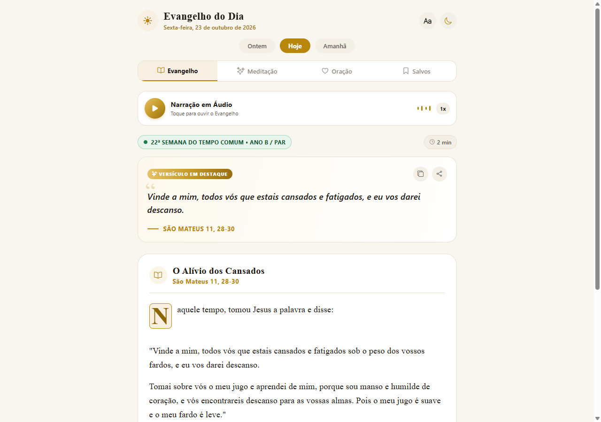
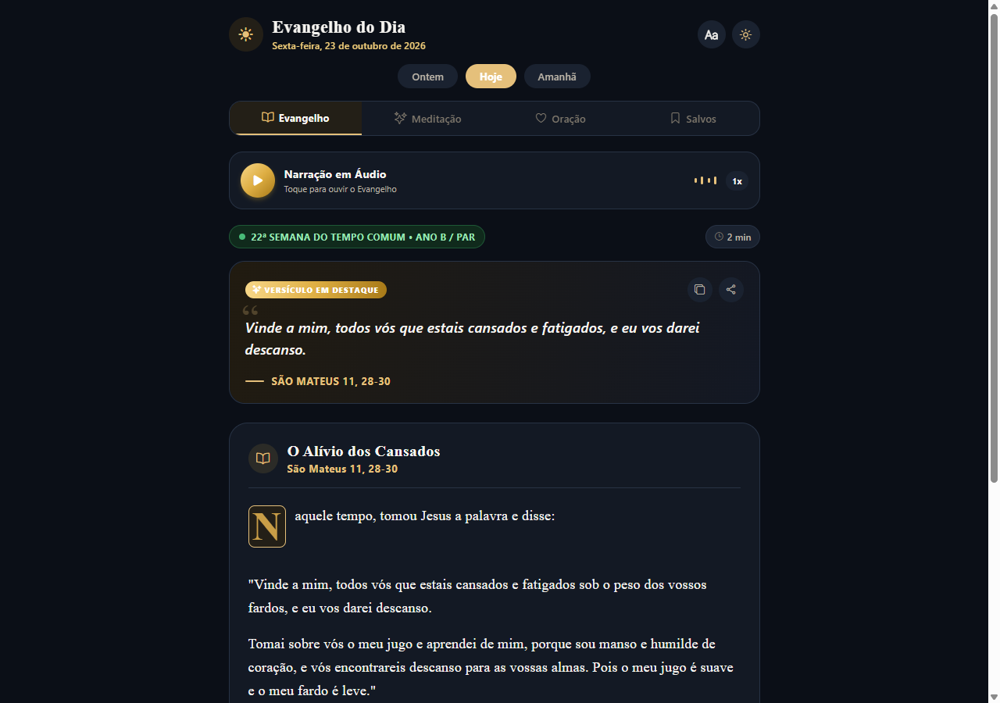
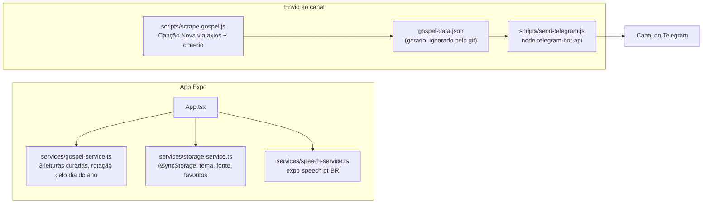

<div align="center">

# 📖 Evangelho do Dia

**Oração, liturgia e fé diária direto no seu bolso e navegador.**<br/>
Leitura do Evangelho com narração em áudio, meditação, oração e propósito do dia, em tema claro ou escuro.

[](https://github.com/juninmd/evangelho-do-dia/actions/workflows/validate.yml)
[](https://github.com/juninmd/evangelho-do-dia/actions/workflows/deploy.yml)
[](LICENSE)

<br/>

<picture>
  <source media="(prefers-color-scheme: dark)" srcset=".github/assets/screenshots/dark.png" />
  
</picture>

</div>

## 📝 Descrição

O **Evangelho do Dia** é um aplicativo mobile e web reimaginado para levar a experiência de oração e liturgia diária ao ápice da serenidade e beleza visual. Inspirado no design editorial sacro e em princípios contemplativos, o app oferece o Evangelho completo, homilias, orações, narração em áudio e propósitos espirituais diários.

## ✨ Destaques de UI/UX & Funcionalidades

- 🕊️ **Design Litúrgico Transcendente**:
  - Paleta nobre inspirada nas cores litúrgicas da Igreja Católica (Verde, Branco/Dourado, Roxo, Vermelho e Rosa).
  - Tema Claro ("Pergaminho Sagrado") e Tema Escuro ("Santuário Noturno") com alternância fluida em um toque.
  - Capitular iluminada clássica para abertura dos textos sagrados.
- 🔊 **Narração em Áudio (Text-to-Speech)**:
  - Ouça a proclamação do Evangelho em português brasileiro com controle de reprodução e velocidade ajustável (0.8x, 1.0x, 1.2x).
  - Efeito visual de ondas sonoras animadas durante a leitura.
- 🔠 **Ajuste Tipográfico Dinâmico**:
  - Modal com 4 níveis de escala tipográfica (Compacto, Padrão Nobre, Grande e Leitura Ampliada) para o máximo conforto de leitura.
- 📅 **Navegação Temporal Litúrgica**:
  - Alternância rápida entre leituras de **Ontem**, **Hoje** e **Amanhã**.
- 🕊️ **Seções Contemplativas**:
  - **Evangelho**: Texto sagrado com diálogo litúrgico interativo ("Glória a vós, Senhor").
  - **Meditação**: Homilética explicativa e provocação espiritual para o coração.
  - **Oração & Propósito**: Oração diária e propósito prático de caridade com marcação de cumprimento.
  - **Favoritos**: Guarde suas passagens mais marcantes para revisitar a qualquer momento.
- 📤 **Partilha & Cópia**:
  - Compartilhamento nativo de passagens formatadas com citações e emojis para WhatsApp, Telegram e redes sociais.

## 🖼️ Telas

| Tema claro ("Pergaminho Sagrado") | Tema escuro ("Santuário Noturno") |
|---|---|
|  |  |

## 🛠️ Tech Stack

- **Framework**: [Expo SDK 51](https://expo.dev/) (React Native & Web)
- **Linguagem**: TypeScript
- **Áudio**: `expo-speech`
- **Ícones & Gradientes**: `@expo/vector-icons`, `expo-linear-gradient`
- **Persistência**: `@react-native-async-storage/async-storage`
- **Scraper**: Node.js + Cheerio + Axios
- **Envio**: `node-telegram-bot-api`

## 🗺️ Como funciona



- O app não busca o Evangelho na internet em tempo de execução: as leituras ficam em `services/gospel-service.ts` e são escolhidas pelo dia do ano.
- O scraper é um passo separado. Ele gera `gospel-data.json`, que só o `send-telegram.js` consome.
- Tokens do Telegram vêm só de variáveis de ambiente; nada sensível fica no repositório.

## 🚀 Como Rodar Localmente

1. Clone o repositório:
   ```bash
   git clone https://github.com/juninmd/evangelho-do-dia.git
   cd evangelho-do-dia
   ```

2. Instale as dependências:
   ```bash
   npm install
   ```

3. Inicie o Expo:
   ```bash
   npm start          # servidor de desenvolvimento do Expo
   # ou para web:
   npm run web        # abre o app no navegador
   ```

4. Verificação de tipos:
   ```bash
   npx tsc --noEmit   # checa os tipos TypeScript sem gerar arquivos
   ```

5. Scripts do bot (opcional):
   ```bash
   npm run scrape           # baixa a leitura do dia para gospel-data.json
   npm run send-telegram    # envia gospel-data.json ao canal (exige as variáveis abaixo)
   ```

## ⚙️ Configuração

Variáveis de ambiente usadas por `scripts/send-telegram.js`. Copie `.env.example` para `.env` localmente; o `.env` não é versionado.

| Nome | Propósito | Obrigatória | Exemplo |
|---|---|---|---|
| `TELEGRAM_BOT_TOKEN` | Token do bot criado no @BotFather | Sim, para `send-telegram` | `123456:ABC-exemplo` |
| `TELEGRAM_CHAT_ID` | ID do canal de destino (costuma começar com `-100`) | Sim, para `send-telegram` | `-1001234567890` |

## 📚 Documentação

| Guia | Conteúdo |
|---|---|
| [QUICKSTART.md](QUICKSTART.md) | Colocar o app e o bot do Telegram para rodar |
| [TELEGRAM_SETUP.md](TELEGRAM_SETUP.md) | Criar o bot, o canal e obter o token e o ID do chat |
| [SCRAPER_GUIDE.md](SCRAPER_GUIDE.md) | Atualizar os seletores CSS do scraper quando o site mudar |
| [CONTRIBUTING.md](CONTRIBUTING.md) | Como reportar bugs e enviar pull requests |

## 🚧 Limitações conhecidas

- O app mostra três leituras curadas (`services/gospel-service.ts`), rotacionadas pelo dia do ano. Não é o Evangelho oficial do dia em todas as datas.
- `scripts/scrape-gospel.js` depende da estrutura HTML do site da Canção Nova; mudanças no site exigem atualizar os seletores (veja [SCRAPER_GUIDE.md](SCRAPER_GUIDE.md)).
- A narração usa a voz pt-BR disponível no dispositivo ou navegador, então a qualidade varia.

> [!NOTE]
> O `send-telegram.js` precisa do token e do ID do canal em variáveis de ambiente. Sem elas, o script não envia nada.

## 📦 Deployment

A versão web é servida via **Nginx** no cluster **K3s**.

- **URL Web**: [https://evangelho.antonio-code.duckdns.org](https://evangelho.antonio-code.duckdns.org)
- **Painel ArgoCD**: [https://argocd.antonio-code.duckdns.org](https://argocd.antonio-code.duckdns.org)

## 📄 Licença

MIT. Veja [LICENSE](LICENSE). Copyright (c) 2026 Evangelho do Dia.
